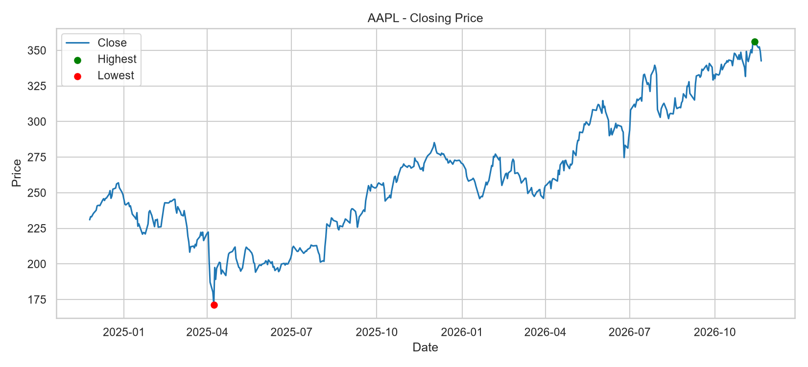
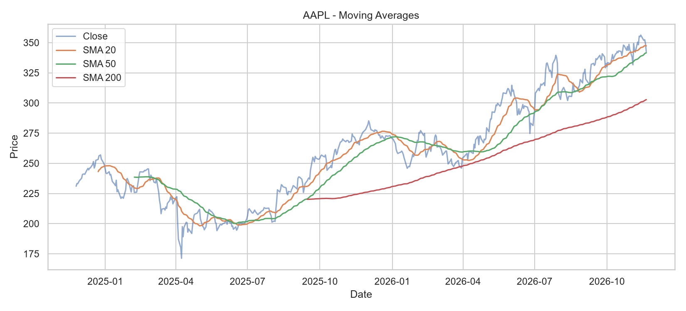
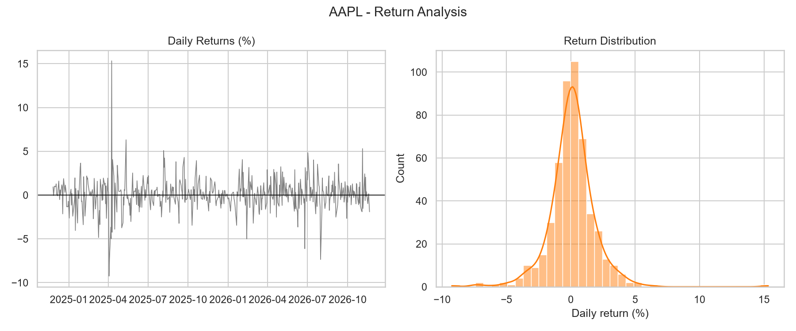
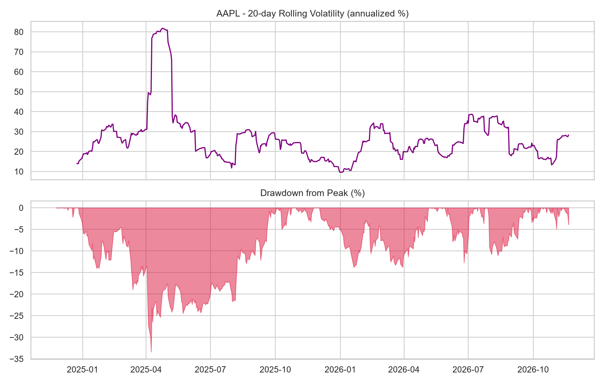

# 📈 Stock Market Data Analyzer

A beginner-friendly Python project that fetches stock price data, cleans it, computes technical indicators (moving averages, returns, volatility, drawdown), draws charts, and generates a written insights report. Includes an optional Streamlit dashboard.

> **Disclaimer:** This project is for educational purposes only and is **not financial advice**.

## Problem Statement
Raw stock prices are hard to interpret. Investors and analysts need quick answers: Is the trend up or down? How risky is the stock? How did it perform? This tool automates that analysis.

## Industry Relevance
Investment research, equity analysis, risk monitoring, and FinTech products all start with the same steps: collect price data, compute returns and volatility, and visualize trends. This project mirrors that workflow.

## Features
- Data from Yahoo Finance (`yfinance`) with CSV fallback and demo-data fallback
- Data cleaning (types, duplicates, missing values)
- Daily and cumulative returns
- SMA 20 / 50 / 200 moving averages and trend detection
- Annualized volatility, Sharpe ratio, max drawdown
- Highest / lowest price analysis
- 4 saved charts + text report + processed CSV
- Optional Streamlit dashboard

## Tech Stack
Python · Pandas · NumPy · Matplotlib · Seaborn · yfinance · Streamlit

## Folder Structure
```
Stock-Market-Data-Analyzer/
├── data/          raw CSV files
├── notebooks/     Jupyter experiments
├── src/           data_loader, cleaner, analysis, visualize, report
├── outputs/       processed CSV
├── images/        saved charts
├── reports/       text insight reports
├── docs/          extra documentation
├── app.py         Streamlit dashboard
├── main.py        run the full pipeline
├── requirements.txt
└── .gitignore
```

## How to Run
```bash
python -m venv venv
venv\Scripts\activate          # Windows   (Mac: source venv/bin/activate)
pip install -r requirements.txt
python main.py --ticker AAPL --start 2024-01-01 --end 2025-12-31
streamlit run app.py           # optional dashboard
```
Indian stocks: `python main.py --ticker TCS.NS` or `RELIANCE.NS`.

## Sample Output
See `reports/AAPL_report.txt` and the charts in `images/`.

## Screenshots
| Closing Price | Moving Averages |
|---|---|
|  |  |
| **Daily Returns** | **Volatility & Drawdown** |
|  |  |

## Learning Outcomes
Pandas time-series handling, rolling statistics, financial metrics (returns, volatility, drawdown, Sharpe), data visualization, modular code design, Git/GitHub workflow.

## Future Improvements
Strategy backtesting, multi-stock comparison, alerts, FastAPI backend.
